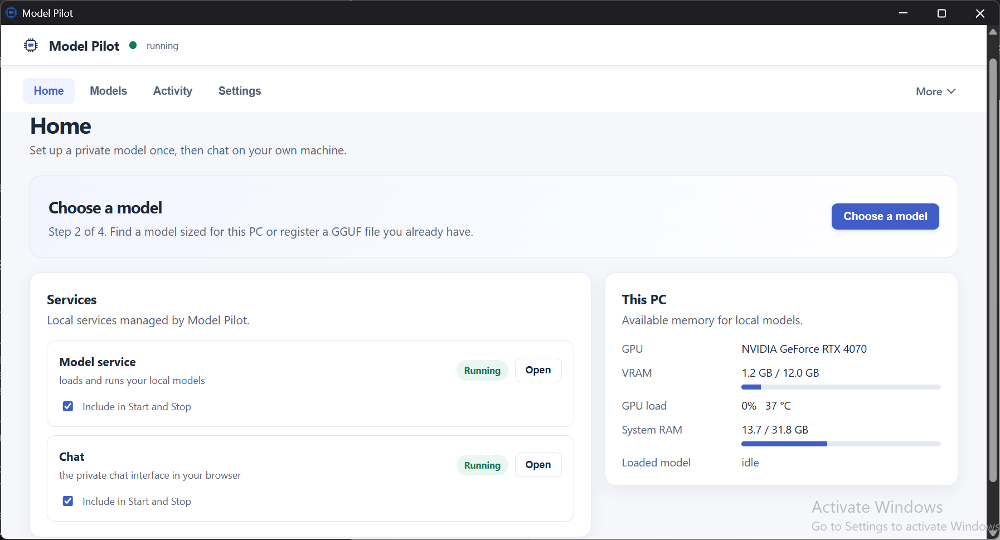
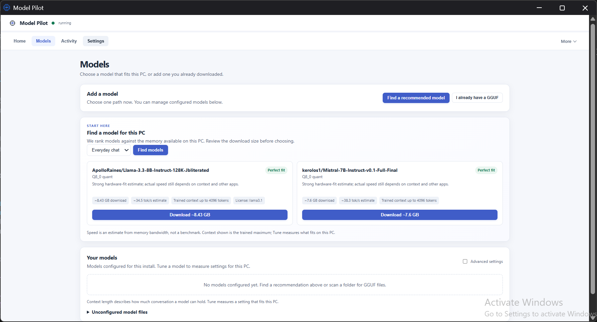
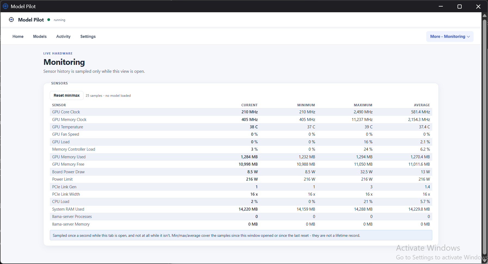

<div align="center">

# Model Pilot

**Private local AI on Windows, without assembling the stack yourself.**

[](https://github.com/hgaaditya/modelpilot/releases/latest)
[](https://github.com/hgaaditya/modelpilot/releases/latest)
[](LICENSE)
[](#what-you-need)

[**Download for Windows**](https://github.com/hgaaditya/modelpilot/releases/latest) · [How it works](#your-first-local-model) · [Use an existing model](#bring-your-own-gguf) · [Advanced setup](#advanced)

</div>

---

## Your first local model

<p align="center">
  
</p>

Model Pilot is a Windows desktop control panel for a local chat stack. It installs per user, keeps its runtime private to its install folder, and gives you **one next step** instead of a pile of services to connect.

| You want to… | Model Pilot does |
| --- | --- |
| Run a model without learning the plumbing | Downloads and starts the local runtime when you press **Start**. No Docker, WSL, Python, Node, PATH edits, or administrator access. |
| Pick a model that fits this PC | Shows hardware-fit recommendations with quantisation, approximate download size, estimated speed, and trained context. |
| Use weights you already have | Scans a folder for GGUF files and registers the original path. It never copies, moves, or deletes your files. |
| Know that it actually works | Sends a short real completion through the local router before you open chat. |
| Keep control of local data | Models, configuration, and chat data stay local by default. Diagnostics are redacted; backups remain on your machine. |

### 1. Install

1. Open the [latest release](https://github.com/hgaaditya/modelpilot/releases/latest).
2. Download **`Model-Pilot-Setup.exe`** and **`SHA256SUMS.txt`**.
3. Verify the download, then run the setup EXE. It creates Start Menu and optional Desktop shortcuts.
4. Launch **Model Pilot** and press **Start**.

> [!IMPORTANT]
> Releases are currently **unsigned**. Windows may show an Unknown Publisher or SmartScreen warning. Download only from this repository’s Releases page and verify the EXE against its attached `SHA256SUMS.txt`. A checksum detects corruption or alteration only when you obtained the checksum from a trusted release page; it does not establish publisher identity.

<details>
<summary><strong>Verify the download in PowerShell</strong></summary>

```powershell
Get-FileHash .\Model-Pilot-Setup.exe -Algorithm SHA256
Get-Content .\SHA256SUMS.txt
```

Compare the hash values. The checksum file uses the standard `sha256sum` format, so it can also be checked by compatible tooling.

</details>

### 2. Let it prepare the local stack

The installer contains Model Pilot’s launcher and scripts, not the large runtime or model weights. The first **Start** downloads the pinned components from their upstream sources, takes roughly 20–30 minutes on a normal connection, and uses about 4 GB before model weights.

Nothing preinstalled is required. Model Pilot fetches private copies of what it needs into its install folder and does not modify the Python or Node installation already on your machine.

### 3. Choose, verify, chat

Open **Models** and choose one of two paths:

- **Find models** — recommendations for everyday local chat, ranked for your hardware.
- **Find models on your drive** — register existing GGUF weights without moving them.

When a model is ready, Home offers **Test a real response**. It may cold-load the model, then shows the result or the specific failure. Open chat when that test succeeds.

<p align="center">
  
</p>

---

## The part that usually goes wrong

A local model is not one download. It is a set of decisions: which quantisation fits, how much context the machine can afford, whether the server is healthy, and whether a configuration still points at a real file.

Model Pilot owns that boring middle layer:

| Instead of… | You get… |
| --- | --- |
| Guessing which model might fit | Hardware-fit recommendations and explicit estimates before the download. |
| Finding a server error after opening chat | A guided real-response check through the same local router chat uses. |
| Rebuilding configuration after every experiment | A visible model list, health checks, and validation against files on disk. |
| Losing a working setup to an update | In-panel update, readiness checks, local backup/restore, and redacted diagnostics. |

The supported everyday path stays deliberately small: **start services → choose a model → verify one response → chat**. System controls and hardware monitoring stay available under **More** when you need them.

---

## Bring your own GGUF

Already have a model folder? Model Pilot can use it in place.

1. Go to **Models → Find models on your drive**.
2. Select the folder containing your GGUF files.
3. Choose **Scan folder**.
4. Review the discovered files and select **Add to Models**.

The original file remains where it is. Already-registered weights are hidden from the scan, duplicate model IDs are surfaced as conflicts, and an inaccessible folder is reported as incomplete rather than silently treated as empty.

---

## What you need

- **Windows 10 or 11 desktop.** The installer, panel, and tray are Windows-only.
- **Disk space:** about 4 GB for the runtime after first setup, plus model weights—commonly 2–20 GB each.
- **Hardware:** an NVIDIA GPU is recommended for useful speed. CPU-only works, but is slow. Exact model fit depends on VRAM, quantisation, context length, and what else is running.
- **Nothing else.** No Docker, WSL, Python, Node, package manager, or administrator account required.

Phones, tablets, macOS, and Linux are not supported install targets.

---

## Everyday controls

| Where | What it is for |
| --- | --- |
| **Home** | The one next step: setup, start, choose a model, test a response, or open chat. |
| **Models** | Recommended downloads, existing-GGUF registration, and model availability. |
| **Activity** | Progress and history for long-running work, with technical details on demand. |
| **Settings** | Updates, backups, restore, readiness checks, diagnostics, storage, and startup. |
| **More → System** | Local service details and compatible API endpoints. |
| **More → Monitoring** | Live GPU/CPU sensor readings while the view is open. |

Closing the panel minimizes it to the system tray; active models keep serving. To stop everything, use the tray menu’s **Stop** command.

<p align="center">
  
</p>

<details>
<summary><strong>Recovery, removal, and privacy details</strong></summary>

- **Backups** include Model Pilot configuration, panel preferences, and Open WebUI data. They exclude weights, logs, download caches, and runtime binaries. Store them privately: they can contain session data.
- **Diagnostics** are designed to exclude chats, prompts, logs, local paths, usernames, machine name, tokens, model names, and weights. Review every archive before sharing it.
- **Uninstall** stops Model Pilot’s local services, panel, and tray before removing the launcher and shortcuts. It deliberately retains downloaded runtime, models, configuration, chats, and logs.
- To remove downloaded components and local chat data, use **Settings → Remove parts of the install → Everything**. Model folders outside the Model Pilot installation are always retained.

</details>

---

## Advanced

### Use the local models from another tool

Model Pilot’s local router exposes OpenAI- and Anthropic-compatible API shapes on the same port. Use the literal IPv4 address, not `localhost`: Windows can resolve `localhost` to IPv6 first while these services bind IPv4 only.

```text
http://127.0.0.1:9292/v1/chat/completions    OpenAI-compatible
http://127.0.0.1:9292/v1/messages            Anthropic-compatible
```

The **Engine** view lists the active endpoints and ready model IDs. These endpoints are for compatible clients; Model Pilot does not install, configure, update, or support external coding-agent CLIs.

### Use the terminal when you mean to

For everyday use, start and stop from Home or the tray. Advanced maintenance and model operations remain available through PowerShell:

```powershell
powershell -ExecutionPolicy Bypass -File .\start.ps1 -Action status
powershell -ExecutionPolicy Bypass -File .\start.ps1 -Action test-model -Id 'your-model-id'
```

Other maintenance actions include `upgrade`, `autotune`, `bench`, `check-config`, `check-ui`, `suggest`, `install-llmfit`, `install-prism`, `autostart`, and `uninstall`.

<details>
<summary><strong>Build the installer from source</strong></summary>

Install **Inno Setup 6**, then run this from the repository root:

```powershell
ISCC.exe installer\ModelPilot.iss
```

The distributable setup file is `installer\output\Model-Pilot-Setup.exe`.

</details>

---

## Status and support

The latest public release is **0.1.16**. This branch contains the next development candidate, **0.1.17**; it is not a public release until a maintainer completes offline Windows/GPU acceptance testing and creates a version tag. Dependency scans may produce candidate artifacts, but never create a product tag or GitHub Release on their own.

For supported product boundaries and interface decisions, see [Product scope](docs/PRODUCT_SCOPE.md). For exact model support guarantees, see [Model support](MODEL_SUPPORT.md).

Need help? Use the panel’s **GitHub support** link or [open an issue](https://github.com/hgaaditya/modelpilot/issues/new/choose) with the application version, Windows version, reproduction steps, and exact error. Review logs and diagnostics before attaching them: they may still reveal hardware and drive details. Do not attach weights, secrets, or chat history unless you deliberately intend to share them.

For a security vulnerability, follow [SECURITY.md](SECURITY.md) instead of posting exploit details publicly.

---

## Trust and project details

- Model Pilot’s control panel binds to `127.0.0.1` and rejects cross-origin requests. It assumes a single-user desktop: other programs running as you can reach local services.
- Model Pilot adds no telemetry or analytics service. First-run setup and optional installs contact component distributors and package indexes; model weights have their own upstream terms.
- The [supply-chain manifest](supply-chain.json) lists pinned bootstrap components and their upstream distribution locations.
- The project is [MIT licensed](LICENSE). Fork the code freely, but use your own name; see [NAMING.md](NAMING.md).
- Contributions follow [CONTRIBUTING.md](CONTRIBUTING.md). Third-party licenses and model-weight terms remain separate; see [THIRD-PARTY.md](THIRD-PARTY.md).
